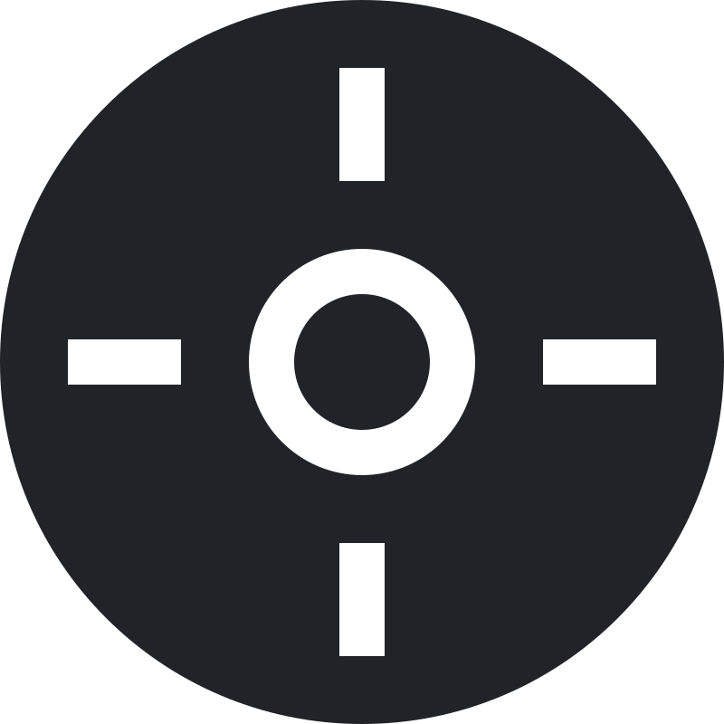

# Reclaim ⏳

<p align="center">
  
</p>

<p align="center">
  <strong>Local-First Digital Wellbeing, Granular Content Blocker & Focus Management for Android</strong>
</p>

<p align="center">
  <a href="https://reactnative.dev"></a>
  <a href="https://kotlinlang.org"></a>
  <a href="https://www.typescriptlang.org"></a>
  <a href="https://developer.android.com"></a>
  
  
</p>

---

## 📖 Overview

**Reclaim** is a digital wellbeing and distraction-blocking application built with **React Native** and **native Kotlin**. Unlike traditional app lockers that bluntly shut down entire applications, Reclaim offers **surgical, content-level blocking**. It eliminates addictive, infinite-scroll feeds (like **YouTube Shorts**, **Instagram Reels**, and **Snapchat Spotlight**) while preserving full access to regular feeds, search, messages, educational long-form videos, and work tools.

### 🔒 100% Local-First & Zero Backend
Reclaim is designed strictly with a **privacy-first, local-first architecture**:
- **Zero Cloud Servers**: No Node.js backend, no Firebase, no Supabase, and no remote databases.
- **Zero Tracking**: All preferences, schedules, restrictions, and statistics remain solely on your device.
- **Ultra-Fast Persistence**: Powered by `react-native-mmkv` v4 for instant local read/writes that survive device restarts and reboots.

---

## ✨ Key Features

### 1. In-App YouTube Shorts Blocking Overlay
- **Non-Intrusive**: Overlays only the Shorts player area while leaving YouTube's native bottom navigation bar (`Home`, `Shorts`, `Create`, `Subscriptions`, `You`) completely visible and interactive.
- **Dynamic Inset Calculation**: Computes exact status bar insets and navigation bar bounds dynamically—no hardcoded coordinates or cut-off interfaces.
- **Instant Audio Control**: Requests transient audio focus to instantly pause video sound playback behind the blocking view.
- **Mindful Exit**: Includes a quick action to step back to YouTube Home with a transient grace window.

### 2. Addictive Short-Form Feed Restriction
- **YouTube Shorts**: Blocks the vertical short-video feed while keeping long-form videos, search, and subscriptions fully accessible.
- **Instagram Reels**: Intercepts the full-screen Reels viewer while keeping messages, home feed posts, and profiles intact.
- **Snapchat Spotlight**: Restricts the endless Spotlight viewer while preserving chats and personal snaps.

### 3. Dynamic Island & Status Bar Live Counter
- When short-form content is temporarily unblocked or during a breather pass, a persistent, high-priority status bar capsule (compatible with Android Dynamic Island, HyperOS notch, and ColorOS Aqua Dynamics) displays a **real-time scroll counter** (`⚡ X Shorts/Reels scrolled`).
- Includes a one-tap **"Re-block Now"** notification action to immediately restore protections.

### 4. Daily App Limits Engine
- Discovers installed, launchable applications dynamically from the Android Package Manager.
- Allows configuring daily usage limits per app with preset chips (15m, 30m, 40m, 1h, 2h, etc.) or custom durations.
- Automatically tracks foreground time via Android's `UsageStatsManager` and enforces blocking once daily limits are reached.

### 5. Website Blocking Across Web Browsers
- Real-time accessibility URL inspection across major Android web browsers (Google Chrome, Mozilla Firefox, Microsoft Edge, Brave, Opera, and Samsung Internet).
- Blocks domain lists (e.g., adult content, distracting forums, social feeds) with instant redirects to the Reclaim focus shield.

### 6. Strict Mode & Anti-Bypass Protections
- **Anti-Uninstall Protection**: Integrates with Android `DevicePolicyManager` (Device Administrator API) and Settings monitoring to prevent removing Reclaim during active sessions.
- **Split-Screen Protection**: Detects and blocks restricted apps launched in multi-window mode.
- **Floating Window & PiP Protection**: Prevents bypassing restrictions via Picture-in-Picture or OEM floating mini-windows.

### 7. Deep Focus Sessions & Pomodoro
- Flexible focus modes: **Timer**, **Stopwatch**, and **Pomodoro** (25m Focus / 5m Break / 4 Cycles).
- Interactive swipeable top tabs powered by `react-native-pager-view` and modern gesture-driven `@gorhom/bottom-sheet`.

---

## 🎨 Design System

- **Typography**: Complete integration of Google Sans (`GoogleSans-Regular`, `Medium`, `SemiBold`, `Bold`, `Italic`) with auto-normalized weight and style mapping via [AppText.tsx](file:///c:/reclaim/src/components/AppText.tsx).
- **Navigation Bar**: Material 3 persistent 3-tab navigation bar (`Focus`, `Schedule`, `Blocks`) with soft stadium pill indicators (`borderRadius: 100`) and custom vector SVGs.
- **Edge-to-Edge Ready**: Full Android 15 & 16 safe-area compatibility with camera cutout and display notch protection via `react-native-safe-area-context`.
- **Zero PRO Paywalls**: 100% clean, distraction-free interface with all upsell banners and PRO badges removed.

---

## 📂 Project Structure

```
reclaim/
├── assets/
│   ├── fonts/                       # Google Sans font family (.ttf)
│   └── icons/                       # Vector SVG icons & index.tsx
│
├── android/
│   └── app/src/main/
│       ├── java/com/reclaim/
│       │   ├── MainActivity.kt      # Main React Native Activity
│       │   ├── MainApplication.kt   # App initialization & package registration
│       │   ├── accessibility/       # AccessibilityService (unified node inspector)
│       │   ├── admin/               # Device Administrator receiver
│       │   ├── blocking/            # BlockingActivity & in-app ShortsOverlayBlocker
│       │   ├── bridge/              # Native modules & event emitters
│       │   ├── detection/           # ShortsDetectionEngine & heuristic scorer
│       │   ├── island/              # DynamicIslandManager status bar capsule
│       │   ├── schedule/            # Scheduled downtime manager & alarms
│       │   ├── session/             # Focus session native state machine
│       │   └── stats/               # Android UsageStatsManager helper
│       └── res/
│           ├── layout/              # Native overlay XML layouts
│           └── xml/                 # Accessibility & Device Admin policies
│
├── src/
│   ├── bridge/                      # TypeScript wrapper for Native Kotlin modules
│   ├── components/                  # Reusable components (AppText, Icon, Card, Button, Header, SwitchRow)
│   ├── navigation/                  # Root and persistent Bottom Tab Navigator
│   ├── screens/
│   │   ├── Blocks/                  # App Limits, Shorts, Websites, Strict Mode
│   │   ├── Focus/                   # Focus dial, Timer, Stopwatch, Pomodoro sheet
│   │   ├── Schedule/                # Automated routines & recurring downtime
│   │   ├── Home/                    # Quick status dashboard
│   │   ├── Permissions/             # Transparent permission setup flow
│   │   ├── Settings/                # Strict Mode, PIN protection, theme toggles
│   │   └── Statistics/              # Usage analytics & distraction metrics
│   ├── store/                       # Local MMKV persistence & AppContext store
│   ├── theme/                       # Colors, Google Sans typography, spacing
│   └── types/                       # TypeScript interfaces and contracts
│
├── __tests__/                       # Jest unit & component tests
├── DEVELOPMENT.md                   # Detailed technical & architectural notes
├── package.json
└── react-native.config.js           # Font asset linking configuration
```

---

## 🚀 Getting Started

### Prerequisites
- **Node.js**: `v18+` (LTS recommended)
- **Java Development Kit**: JDK 17
- **Android SDK**: `compileSdk = 37`, `targetSdk = 36`, `minSdk = 24`
- **Android Device or Emulator**: Android 8.0 (API 26) or higher (Android 14–16 recommended for edge-to-edge testing)

### Installation

1. Clone the repository:
   ```bash
   git clone https://github.com/your-username/reclaim.git
   cd reclaim
   ```

2. Install dependencies:
   ```bash
   npm install --legacy-peer-deps
   ```

3. Start Metro bundler:
   ```bash
   npm start
   ```

4. Build and install on connected Android device:
   ```bash
   npm run android
   ```

---

## 🧪 Testing & Code Quality

Reclaim enforces strict type safety and test coverage:

- **Type Check**:
  ```bash
  npx tsc --noEmit
  ```
- **Linting**:
  ```bash
  npm run lint
  ```
- **Unit & Integration Tests**:
  ```bash
  npm test
  ```

---

## 🔐 Required Android Permissions

To reliably detect and block distractions, Reclaim requests the following permissions transparently:

| Permission | Purpose |
| :--- | :--- |
| **Accessibility Service** | Detects active UI hierarchy elements (YouTube Shorts, IG Reels, browser URLs) to trigger blocking overlays. |
| **Usage Access (`PACKAGE_USAGE_STATS`)** | Queries daily app screen time to enforce configured Daily App Limits. |
| **Display Over Other Apps (`SYSTEM_ALERT_WINDOW`)** | Renders the in-app blocking overlay over YouTube Shorts and blocked applications. |
| **Notifications (`POST_NOTIFICATIONS`)** | Displays the Dynamic Island / Aqua Dynamics live counter when content is unblocked. |
| **Device Administrator** | *(Optional)* Protects Reclaim from unauthorized uninstallation while Strict Mode is active. |

---

## 📄 License

This project is open-source and available under the [MIT License](LICENSE).
